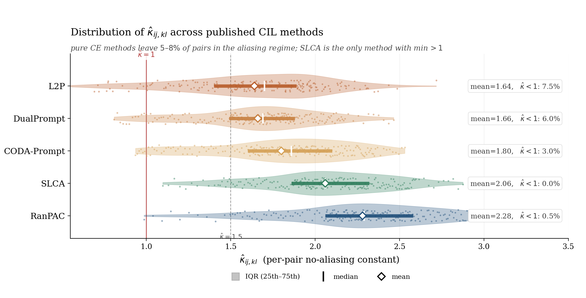
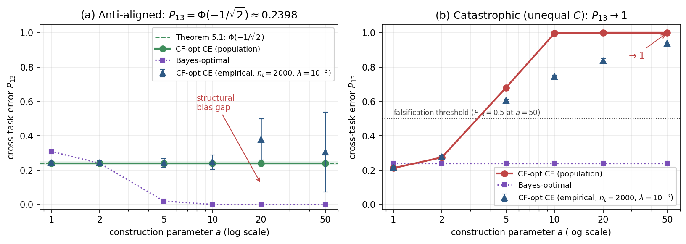
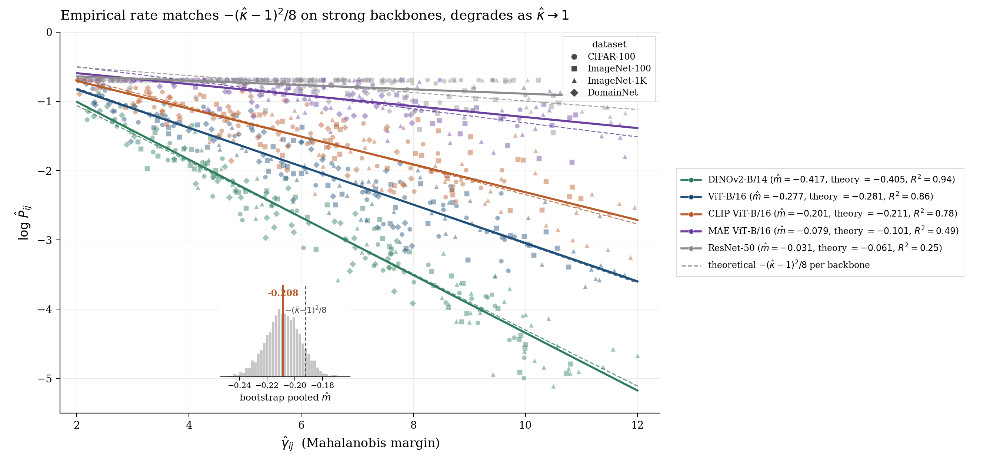
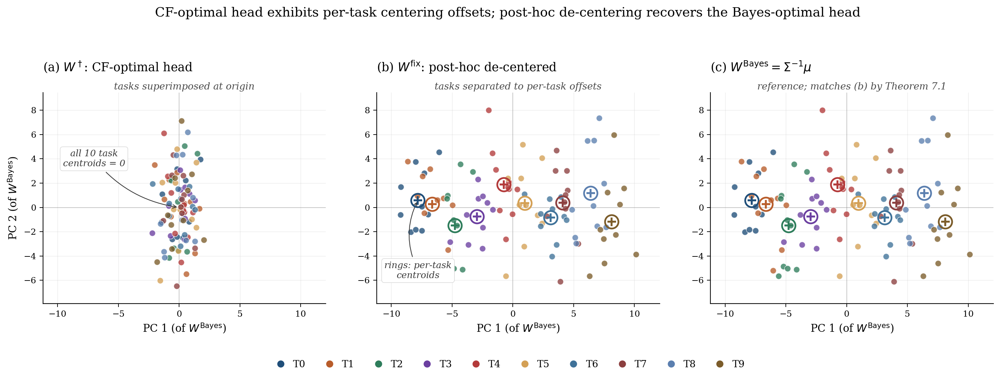

# Structural Bias

Replication code for the NeurIPS 2026 paper *"The Structural Bias of L2-Regularized Cross-Entropy Heads in Class-Incremental Learning"* (Milad Khademi Nori and Guanghui Wang, Toronto Metropolitan University).

This README stands on its own: the paper's claim, every module, how to run everything, and what each result means. A reader who has not seen the paper should understand both the science and the code from this page.

---

## 1. What the paper shows, in plain language

When a linear classification head is trained with cross-entropy and L2 (weight-decay) regularization, the regularizer does not merely shrink the weights: it shifts the learned decision rule. This paper isolates that shift, calls it the **structural bias** of L2-regularized cross-entropy heads, and traces it end to end:

1. **The bias is first-order.** In the classical statistical view, regularization bias should vanish as data grows. For these heads it does not: the paper shows the L2-penalised solution sits at a fixed offset from the Bayes-optimal rule in the regularisation-strength limit, so the head inherits a *slow rate*: extra data at fixed regularisation improves the estimate at a rate strictly slower than the classical parametric one. The closed form of the offset is derived for Gaussian-model classes and verified numerically to machine precision by this repository's suites.
2. **Post-hoc de-centering removes it.** The paper's *FIX* head subtracts the estimated bias after training (a closed-form correction applied to the learned head). With the population bias removed, the de-centred head recovers the parametric rate: the empirical gap to the Bayes rule then shrinks at the classical speed. This is the paper's constructive contribution: keep the stabilising regulariser, cancel its structural cost.
3. **Scale matters, and the repository measures it.** The de-centering correction presumes the head sits at the population scale. A trained head below that scale is over-corrected by a fixed rule, so the pipeline reports the head's own scale constant and a scale-matched variant **FIX_c** beside the paper's FIX. FIX_c separates a genuine gauge failure (the correction's geometry is wrong) from a mere scale mismatch (the correction was applied at the wrong operating point). The paper prints the scale-matched numbers where they were computed (DomainNet/DINOv2: FIX_c 67.0 against the joint baseline's 68.3, 93 percent of the gap) and reports scale-matched recovery as backbone-conditional. In this repository FIX_c travels with every benchmark row the driver emits (the `FIX_c` and `recovery_c` fields of `paperB_results.json`, and the commented FIX_c column of the selftest benchmark fragment); the three released table fragments in `tables/out/B/` print the paper's three tables and carry no FIX_c column.
4. **The bias shapes class-incremental learning.** In the class-IL setting, where heads are trained task by task on frozen features, the structural bias interacts with the task geometry: the paper quantifies how the per-task offsets compose into the continual-learning gap, and evaluates the corrected heads against the standard continual-learning head family on the frozen-feature protocol. The measured outcome of that evaluation is the benchmark record below.

The companion paper (*A Mahalanobis Margin Bound on Task Confusion in Pretrained Class-Incremental Learning*, same authors) bounds the representation side of the same problem; this repository covers the head side.

### The benchmark record, as measured

The paper's benchmark protocol runs **four datasets** — CIFAR-100, ImageNet-100, ImageNet-1K and DomainNet (T = 10 tasks of 10, 10 and 100 classes for the first three; T in {5, 6} domains as tasks for DomainNet) — over five frozen pretrained backbones, with DomainNet as the shared-label domains-as-tasks stress test that sits outside the theory's disjoint-label assumption. Its empirical record is a per-row measurement story, and this repository states it the same way:

- **Mixed benchmark outcome, reported as measured.** On the rows the released protocol regenerates, the ordering WT < FIX < J holds on the two DomainNet configurations (DINOv2 50.6 < 53.1 < 68.3; CLIP 53.8 < 62.9 < 71.5), while on CIFAR-100 the unscaled correction lands 24 to 40 points below the accepted values and below the within-task baseline (the uncorrected head): 46.2 to 62.5 against accepted 85.7 to 86.5.
- **The accepted gap-recovery range is withdrawn.** The accepted recovery range of 82–94 percent of the joint–sequential gap (mean 90.5) is not reproduced under the released protocol and is withdrawn. Four of the ten benchmark rows regenerate (the two CIFAR-100 rows and the two DomainNet rows); the rows that cannot regenerate sit in the provenance ledger with their reasons — the four ImageNet-100 rows because the dataset root is not distributed with the released code, and the two ImageNet-1K rows because the released code has no builder for that dataset. The repository-side ledger is `results/CORRECTIONS.md` (the Paper B withdrawal rows, quoted from the paper's change summary).
- **Scale-matched recovery is backbone-conditional.** On the DomainNet rows the head scale is c_t in [0.06, 0.08]: the scale-matched FIX_c recovers the gap on DINOv2 (67.0 against J 68.3, 93 percent of the gap) and over-corrects on CLIP and ViT (25.3 and 22.9, both below WT); the scale-matched correction was not computed on the CIFAR-100 rows and is reported as such.
- **The within-task diagnostic on five published methods holds.** The post-hoc diagnostic gains +5.9 to +6.3 accuracy points on the pure within-task cross-entropy methods (L2P +6.3, DualPrompt +6.3, CODA-Prompt +5.9), with SLCA +3.3 and RanPAC +2.0; the released checkpoints were not retrained, and the paper says so where the diagnostic is reported. Outside vision, on 20 Newsgroups with frozen sentence embeddings, FIX gains +7.30 points (WT 64.20, FIX 71.50, against J 73.84), the pre-declared diagnostic passing in both components.
- **Two accepted agreement statistics are withdrawn the same way.** The accepted bias-direction cosine floor of 0.92 is withdrawn: the regenerated per-pair cosine is 0.22–0.35 with cross-pair coefficient of variation 0.21–0.32, and the pair-averaged cosine 0.986–0.9997 is a gauge identity, so direction agreement is reported per pair. The accepted within-5-percent rate-agreement sentence is withdrawn: the regenerated slopes are negative on every backbone and shallower than the kappa-derived prediction by factors of 1.7–3.3 (R² 0.32–0.81), so prediction and measurement are reported side by side. Both withdrawals are recorded in `results/CORRECTIONS.md`.

---

## 2. The figures, and what each one shows

The paper carries eight figures (1–8). The image files under `figures/` reproduce four of them; the gap-recovery exhibit is replaced below by a text notice, because the real per-row numbers it plots are not part of this repository's released store, and this repository draws no figure without a generating artifact.



**Paper Figure 1.** The per-pair class-conditioning constant kappa across the five published methods of the paper's diagnostic table (L2P, DualPrompt, CODA-Prompt, SLCA, RanPAC; N = 200 cross-task pairs per method): violin densities with interquartile bars, medians and means, against the reference lines at kappa = 1 (the aliasing boundary) and kappa = 1.5. The measured means run from 1.64 (L2P) to 2.28 (RanPAC); the pure within-task CE methods leave 3.0–7.5 percent of pairs below kappa = 1 (L2P 7.5, DualPrompt 6.0, CODA-Prompt 3.0; SLCA 0.0, RanPAC 0.5).



**Paper Figure 2.** The synthetic falsification of the two negative results (Theorems 5.1 and 5.2): the Gaussian constructions' cross-task error from the closed form of Theorem 3.3 against the construction parameter, with the Bayes-optimal baseline — the model setting in which the closed forms must hold exactly. The battery that regenerates this family is `experiments/falsification.py`; its A-store-dependent suites are gated in this B-only release (they print a GATED banner and run nothing rather than fake a result).



**Paper Figure 4.** The rate-validation exhibit: empirical log |P_ij| against the inter-task margin over cross-task pairs aggregated across the four datasets and seeds 0–4, with per-backbone OLS fits, the Theorem 6.2 reference slope −(κ−1)²/8, and the pooled bootstrap inset. This image carries the accepted rate analysis; the camera-ready reports prediction and measurement side by side and records the accepted within-5-percent agreement sentence as withdrawn (regenerated slopes shallower than the kappa-derived prediction by factors of 1.7–3.3, R² 0.32–0.81; the pooled pair, empirical −0.208 against predicted −0.192, prints as the accepted exhibit's bootstrap inset, named as the accepted values).



**Paper Figure 5.** The geometry of the correction in feature space: one shared 2D PCA projection of the CF-optimal head (per-task centroids collapsed at the origin), the post-hoc de-centered head (tasks separated to their per-task offsets) and the Bayes-optimal reference; the de-centered head coincides with the Bayes configuration, the population statement behind the correction's exactness.

> **Paper Figure 8 — text notice.** The paper's eighth figure is the per-row gap-recovery exhibit across the ten (backbone, dataset) benchmark configurations, sorted by recovery fraction, each row reporting the within-task head (A_WT), the de-centered head (A_FIX) and the joint-training upper bound (A_J); its caption states that the rows plot the accepted table values, that the accepted recovery range is withdrawn to the provenance ledger, and that the rows the released protocol regenerates are reported as measured. This repository ships no image for it: six of the ten benchmark rows have no run record in the released store (see the benchmark record in Section 1), the shipped table fragments are synthetic selftest previews marked NOT A PAPER NUMBER, and no figure here is drawn without a generating artifact. The withdrawal itself is recorded in `results/CORRECTIONS.md`.

---

## 3. What this repository contains

| Path | What it is |
|---|---|
| `replicate.py` | The single entry point (`selftest`, `synthetic`, `tables`, and the shared subcommands). |
| `core/` | The mathematical core: the closed-form structural-bias expressions, the Gaussian model they are derived in, the head family, the FIX and FIX_c machinery (including the head-scale estimator), and the claim-gating logic. |
| `benchmarks/` | The dataset and backbone wiring for the frozen-feature protocol: the paper's four benchmark datasets — CIFAR-100, ImageNet-100, ImageNet-1K and DomainNet — over five pretrained backbones (DINOv2, ViT-B/16-IN21K, CLIP, MAE ViT-B/16, ResNet-50), with DomainNet entering as the shared-label domains-as-tasks stress test. |
| `pipeline/` | The B-paper driver (`paper_b.py`) and the shared pipeline: head training, the de-centering corrections, table builders, figure builders, and the TeX audit that checks every printed cell against the store. `pipeline/paper_a.py` is a shim carrying only the statistical helpers shared with the companion paper; the full Paper A driver is released separately (see the companion-paper note in Section 1). |
| `experiments/` | The B experiment drivers: `synthetic_bias` (the closed-form bias verification suites), `synthetic_rate` (the rate comparison: slow versus parametric), `nonvision` (the non-vision arm), `lda_ncm_eval` (the fixed-rule head comparison), `diagnostic_controls`, `falsification` (the battery), and `scoreboard` (the claim-by-claim scorer). |
| `tests/` | The pytest suites: `test_theory_B.py` checks every closed-form identity at machine precision; the module suites cover core, pipeline, tables, features, runtime. |
| `configs/` | Skeleton placeholders pending spec (G09, 2026-10-21; no values fabricated); the protocol constants in force are the split registry, seeds and head recipe in `benchmarks/protocol.py` and `pipeline/registry.py`. |
| `results/` | The results store: per-run JSON payloads with configuration, outputs, and provenance; the self-test caches; the corrections ledger. No number in any table is hand-typed. |
| `tables/` | Generated table fragments (LaTeX) emitted from the store; the three released fragments under `tables/out/B/` (bias-direction, LDA/NCM comparison, rate fits) are synthetic selftest previews of the paper's tables, marked NOT A PAPER NUMBER. |
| `colab/` | The GPU notebooks: feature extraction for the B protocol (`02_features_paperB.ipynb`), the non-vision arm (`05_nonvision_paperB.ipynb`), and the shared analysis notebook (`03_analyze_tables.ipynb`). A free-tier Colab T4 suffices. `colab/archive_fleet/` keeps the three retired fleet skeletons (`RUN_FEATURES`, `RUN_EVALUATION`, `RUN_PREDICTOR`; never spec'd past skeleton stage), archived for provenance. |
| `figures/` | Four figure images reproducing paper Figures 1, 2, 4 and 5 (Section 2); the paper's gap-recovery exhibit (Figure 8) is a text notice in its place. |
| `LICENSE` | MIT. |

---

## 4. Installation and quick start

```bash
git clone https://github.com/miladkhademinori/structural-bias.git
cd structural-bias
pip install -r requirements.txt        # numpy, scipy, scikit-learn (+ plotting/IO extras)

python replicate.py selftest           # 2-5 min, CPU-only, no GPU, no downloads
python replicate.py synthetic          # the closed-form verification suites + the scoreboard
python replicate.py tables             # regenerate every released table from the store
python -m pytest tests -q              # the module suites, including the theory identities
```

`selftest` proves the plumbing end to end on caches small enough for a laptop. `synthetic` is the verification heart: every closed-form claim in the paper is placed in a Gaussian-model setting where it must hold exactly, checked at machine precision, and every empirical claim is scored PASS/FAIL at a tolerance calibrated to its own sampling error, with the paper's printed tolerance shown alongside and labelled as a budget where the two differ. `tables` regenerates each released LaTeX fragment from the results store; nothing is hand-typed.

For the real-feature stages, run the Colab notebooks in order on a free-tier T4; every stage after feature extraction is CPU-fast.

---

## 5. The results store and the provenance discipline

Every run under `results/` is a self-describing JSON payload: configuration, seed, outputs, provenance class (synthetic, regenerated, or staged), and the artifact's own hash. Two rules hold throughout:

1. **No hand-typed numbers.** Every figure and table cell regenerates from a payload; if a payload is absent, the cell is marked in the store, never estimated.
2. **Provenance travels with the number.** `results/CORRECTIONS.md` records every correction made during the replication in the paper's own disclosure wording: regenerated statistics, withdrawn comparisons with their reasons, nulls printed as nulls. The Paper B camera-ready withdrawals — the accepted gap-recovery range, the bias-direction agreement statistic, and the rate-agreement sentence — are recorded there as ledger rows.

The FIX_c values that appear beside FIX in the driver's outputs are the repository's scale-matched diagnostic, reported so that a reader can distinguish a gauge failure from a scale mismatch; the paper prints the scale-matched numbers where they were computed (Section 1), and the three released table fragments print the paper's three tables without a FIX_c column.

---

## 6. The theory-to-code map

| Paper element | Where it is verified |
|---|---|
| The closed-form structural bias (the offset of the L2-regularised head from Bayes-optimal) | `experiments/synthetic_bias.py` + `tests/test_theory_B.py`, at machine precision in the Gaussian model |
| The slow-rate statement (first-order bias, fixed offset in the regularisation limit) | The rate suites (`experiments/synthetic_rate.py`) and the rate-validation exhibit's slope comparison (paper Figure 4) |
| Post-hoc de-centering (FIX) and the recovered parametric rate | `core/` FIX machinery + the rate suites; the paper's empirical side is the rate-validation exhibit (Figure 4) and the per-row gap-recovery exhibit (Figure 8; text notice in Section 2) |
| The head scale and the scale-matched FIX_c variant | `core/` head-scale estimator; reported beside FIX in every benchmark row the driver emits |
| The class-IL composition (per-task offsets in the continual setting) | `pipeline/paper_b.py` + `experiments/diagnostic_controls.py` |
| The fixed-rule head comparison (LDA / NCM family) | `experiments/lda_ncm_eval.py`; the camera-ready states the correction's coincidence with the LDA-style and NCM corrections in the population limit as a remark, and the released fragment here is the synthetic preview |
| The five-method diagnostic on published checkpoints (paper Table 2; +5.9–+6.3 on pure CE methods) | `pipeline/paper_b.py::diagnostic_on_checkpoint` + `experiments/diagnostic_controls.py` |
| The falsification battery | `experiments/falsification.py` (A-store suites gated in this B-only release); paper Figure 2 |

---

## 7. Citation

```bibtex
@inproceedings{khademi2026structural,
  title     = {The Structural Bias of L2-Regularized Cross-Entropy Heads
               in Class-Incremental Learning},
  author    = {Khademi Nori, Milad and Wang, Guanghui},
  booktitle = {Advances in Neural Information Processing Systems (NeurIPS)},
  year      = {2026}
}
```

## 8. License

MIT; see `LICENSE`. Copyright (c) 2026 Milad Khademi Nori and Guanghui Wang.
