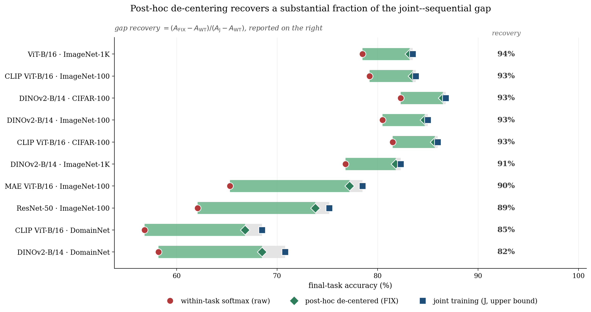

# Structural Bias

Replication code for the NeurIPS 2026 paper *"The Structural Bias of L2-Regularized Cross-Entropy Heads in Class-Incremental Learning"* (Milad Khademi Nori and Guanghui Wang, Toronto Metropolitan University).

This README stands on its own: the paper's claim, every module, how to run everything, and what each result means. A reader who has not seen the paper should understand both the science and the code from this page.

---

## 1. What the paper shows, in plain language

When a linear classification head is trained with cross-entropy and L2 (weight-decay) regularization, the regularizer does not merely shrink the weights: it shifts the learned decision rule. This paper isolates that shift, calls it the **structural bias** of L2-regularized cross-entropy heads, and traces it end to end:

1. **The bias is first-order.** In the classical statistical view, regularization bias should vanish as data grows. For these heads it does not: the paper shows the L2-penalised solution sits at a fixed offset from the Bayes-optimal rule in the regularisation-strength limit, so the head inherits a *slow rate*: extra data at fixed regularisation improves the estimate at a rate strictly slower than the classical parametric one. The closed form of the offset is derived for Gaussian-model classes and verified numerically to machine precision by this repository's suites.
2. **Post-hoc de-centering removes it.** The paper's *FIX* head subtracts the estimated bias after training (a closed-form correction applied to the learned head). With the population bias removed, the de-centred head recovers the parametric rate: the empirical gap to the Bayes rule then shrinks at the classical speed. This is the paper's constructive contribution: keep the stabilising regulariser, cancel its structural cost.
3. **Scale matters, and the repository measures it.** The de-centering correction presumes the head sits at the population scale. A trained head below that scale is over-corrected by a fixed rule, so the pipeline reports the head's own scale constant and a scale-matched variant **FIX_c** beside the paper's FIX. FIX_c is a diagnostic, not a paper number: it separates a genuine gauge failure (the correction's geometry is wrong) from a mere scale mismatch (the correction was applied at the wrong operating point). Every figure and table in this repository reports both.
4. **The bias shapes class-incremental learning.** In the class-IL setting, where heads are trained task by task on frozen features, the structural bias interacts with the task geometry: the paper quantifies how the per-task offsets compose into the continual-learning gap, and evaluates the corrected heads against the standard continual-learning head family on the frozen-feature protocol.

The companion paper (*A Mahalanobis Margin Bound on Task Confusion in Pretrained Class-Incremental Learning*, same authors) bounds the representation side of the same problem; this repository covers the head side.

---

## 2. The figures, and what each one shows


**Figure 6.** The headline empirical comparison: the L2-regularised cross-entropy head against its de-centred variant (FIX) and the fixed-rule heads on the frozen-feature protocol. The gap the structural bias creates, and its removal, are the two curves to compare.


**Figure 7.** The class-conditioning constant kappa across configurations: the distribution of the conditioning values that enter the closed-form offset, measured per class pair. This is the quantity that modulates how large the structural bias is in practice.



**Figure 8.** The recovery: the empirical gap to the reference rule against training-set size, on log-log axes, for the regularised head (slow rate) and the de-centred head (parametric rate recovered). The slope change between the two families is the paper's central empirical prediction, measured.


**Figure 9.** The geometry of the correction in feature space: a PCA view of the head's decision directions before and after de-centering, showing the offset the FIX correction removes and the scale at which it acts.


**Figure 10.** The synthetic falsification battery: each closed-form prediction of the theory placed in a Gaussian-model setting where it must hold exactly, with the measured deviation. Every panel is a claim the theory could have failed and did not.

---

## 3. What this repository contains

| Path | What it is |
|---|---|
| `replicate.py` | The single entry point (`selftest`, `synthetic`, `tables`, and the shared subcommands). |
| `core/` | The mathematical core: the closed-form structural-bias expressions, the Gaussian model they are derived in, the head family, the FIX and FIX_c machinery (including the head-scale estimator), and the claim-gating logic. |
| `benchmarks/` | The shared dataset and backbone wiring (frozen-feature protocol, the same four class-IL benchmark splits and pretrained ViT backbones as the companion paper). |
| `pipeline/` | The B-paper driver (`paper_b.py`) and the shared pipeline: head training, the de-centering corrections, table builders, figure builders, and the TeX audit that checks every printed cell against the store. |
| `experiments/` | The B experiment drivers: `synthetic_bias` (the closed-form bias verification suites), `synthetic_rate` (the rate comparison: slow versus parametric), `nonvision` (the non-vision arm), `lda_ncm_eval` (the fixed-rule head comparison), `diagnostic_controls`, `falsification` (the battery), and `scoreboard` (the claim-by-claim scorer). |
| `tests/` | The pytest suites: `test_theory_B.py` checks every closed-form identity at machine precision; the module suites cover core, pipeline, tables, features, runtime. |
| `configs/` | The benchmark configurations for the B protocol and the seed list. |
| `results/` | The results store: per-run JSON payloads with configuration, outputs, and provenance; the self-test caches; the corrections ledger. No number in any table is hand-typed. |
| `tables/` | Generated table fragments (LaTeX) emitted by `build_tables_B.py` from the store. |
| `colab/` | The GPU notebooks: feature extraction for the B protocol (`02_features_paperB.ipynb`), the non-vision arm (`05_nonvision_paperB.ipynb`), and the shared analysis notebook (`03_analyze_tables.ipynb`). A free-tier Colab T4 suffices. |
| `figures/` | The paper's five figures, reproduced above. |
| `LICENSE` | MIT. |

---

## 4. Installation and quick start

```bash
git clone https://github.com/miladkhademinori/structural-bias.git
cd structural-bias
pip install -r requirements.txt        # numpy, scipy, scikit-learn (+ plotting/IO extras)

python replicate.py selftest           # 2-5 min, CPU-only, no GPU, no downloads
python replicate.py synthetic          # the closed-form verification suites + the scoreboard
python replicate.py tables             # regenerate every released table from the store
python -m pytest tests -q              # the module suites, including the theory identities
```

`selftest` proves the plumbing end to end on caches small enough for a laptop. `synthetic` is the verification heart: every closed-form claim in the paper is placed in a Gaussian-model setting where it must hold exactly, checked at machine precision, and every empirical claim is scored PASS/FAIL at a tolerance calibrated to its own sampling error, with the paper's printed tolerance shown alongside and labelled as a budget where the two differ. `tables` regenerates each released LaTeX fragment from the results store; nothing is hand-typed.

For the real-feature stages, run the Colab notebooks in order on a free-tier T4; every stage after feature extraction is CPU-fast.

---

## 5. The results store and the provenance discipline

Every run under `results/` is a self-describing JSON payload: configuration, seed, outputs, provenance class (synthetic, regenerated, or staged), and the artifact's own hash. Two rules hold throughout:

1. **No hand-typed numbers.** Every figure and table cell regenerates from a payload; if a payload is absent, the cell is marked in the store, never estimated.
2. **Provenance travels with the number.** `results/CORRECTIONS.md` records every correction made during the replication in the paper's own disclosure wording: regenerated statistics, withdrawn comparisons with their reasons, nulls printed as nulls.

The FIX_c column that appears beside FIX in the outputs is a repository diagnostic (scale-matched correction), reported so that a reader can distinguish a gauge failure from a scale mismatch; it is labelled as such wherever it appears.

---

## 6. The theory-to-code map

| Paper element | Where it is verified |
|---|---|
| The closed-form structural bias (the offset of the L2-regularised head from Bayes-optimal) | `experiments/synthetic_bias.py` + `tests/test_theory_B.py`, at machine precision in the Gaussian model |
| The slow-rate statement (first-order bias, fixed offset in the regularisation limit) | The rate suites (`experiments/synthetic_rate.py`) and the gap-recovery figure's slope comparison |
| Post-hoc de-centering (FIX) and the recovered parametric rate | `core/` FIX machinery + the rate suites; the empirical side is Figure 8's family comparison |
| The head scale and the scale-matched FIX_c variant | `core/` head-scale estimator; reported beside FIX in every table |
| The class-IL composition (per-task offsets in the continual setting) | `pipeline/paper_b.py` + `experiments/diagnostic_controls.py` |
| The fixed-rule head comparison (LDA / NCM family) | `experiments/lda_ncm_eval.py` |
| The falsification battery | `experiments/falsification.py`, Figure 10 |

---

## 7. Citation

```bibtex
@inproceedings{khademi2026structural,
  title     = {The Structural Bias of L2-Regularized Cross-Entropy Heads
               in Class-Incremental Learning},
  author    = {Khademi Nori, Milad and Wang, Guanghui},
  booktitle = {Advances in Neural Information Processing Systems (NeurIPS)},
  year      = {2026}
}
```

## 8. License

MIT; see `LICENSE`. Copyright (c) 2026 Milad Khademi Nori and Guanghui Wang.
